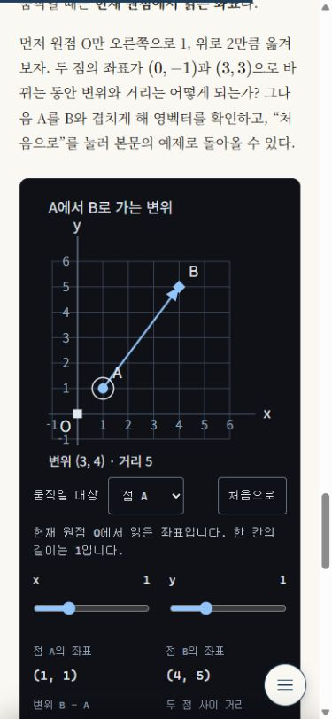

# 기초 1 작성자 검증 인계

- 대상: `src/content/posts/robotics-points-vectors.md`
- 상태: 본문·도판·실험 구현 완료, **독립 내용 리뷰 대기**.
- 기준: [작성 정본](../writing-rules.md), [포스트 스펙](../superpowers/specs/2026-10-16-robotics-points-vectors-design.md).
- 이 문서는 작성자가 준비한 근거다. L1–L7 판정과 strict finalize를 대신하지 않는다. `docs/reviews/`에는 완료된 독립 리뷰만 넣는다.

## 검증할 주장과 전제

직교하는 두 축에 같은 길이 단위를 쓰는 평면이다. 원점 변경에서는 축 방향과 단위를 고정한다.

| 주장 | 본문·도판·실험에서 대조할 근거 |
| --- | --- |
| 변위는 끝점에서 시작점을 뺀다 | A=(1,1), B=(4,5), B−A=(3,4). 역방향은 (−3,−4). |
| 변위의 길이와 경로의 길이는 다르다 | √(3²+4²)=5, 두 직교 변을 따라 이동하면 3+4=7. `length.svg`의 가로/세로 픽셀 길이도 120/160으로 3:4다. |
| 원점 평행이동은 변위 성분을 바꾸지 않는다 | O′=(1,2)에서 A′=(0,−1), B′=(3,3). (B−O′)−(A−O′)=B−A. 본문에는 x와 y 각각의 상쇄를 썼다. |
| 영벡터에는 방향을 정할 수 없다 | A=B이면 차이 (0,0), 거리 0. 실험은 화살촉을 숨기고 «방향 없음»을 표시한다. |
| 위치벡터는 선택한 원점에 의존한다 | OA와 O′A는 다른 출발점을 가지며, 점 A 자체는 그대로다. 축 회전까지 성분 불변이라고 주장하지 않는다. |

자료별 provenance는 스펙에 있다. 선형대수 PDF를 기초 자료로 반영했다. 미분방정식 PDF는 이후 미분·야코비안 보충편용이며 이번 글의 선행 지식으로 요구하지 않는다. 공개 원문 대조는 OpenStax §10.8이다. 본문에는 내부 자료를 인용하거나 파일 경로를 넣지 않았다.

## 실행한 검사

| 검사 | 결과 |
| --- | --- |
| `npm run test:js` | 29개 통과. 원점 이동 불변성·반전·영벡터·입력 한계, 플러그인 fallback·ID 참조·팔레트 포함. |
| `python -m unittest discover -s .claude -p 'test_*.py'` | 최종 실행 220개 통과. 중간 실행의 임시 파일 rename에 Windows 접근 오류가 한 차례 있었고 재실행에서는 재현되지 않았다. |
| `npm run build` | 146개 페이지 생성, 72개 글 본문 검사 통과. 기존 글의 SEO 설명 길이와 Astro 내부 unused import 경고만 남음. |
| `python .claude/review_post.py src/content/posts/robotics-points-vectors.md` | 결정적 지적 0건. 초기에 누락된 SVG 크기 속성과 검사기의 robotics enum을 보완함. |
| `python .claude/review_post.py --gate` | 기존 33개 대상 리포트 통과. 새 글의 독립 리뷰 통과를 뜻하지 않음. |
| `git diff --check` | 통과. |

## 실제 브라우저 확인

빌드된 사이트를 Astro preview로 열고 다음을 확인했다.

- 기본 예시 A=(1,1), B=(4,5), 변위=(3,4), 거리=5.
- O 입력을 (1,2)로 옮기면 A=(0,−1), B=(3,3), 변위=(3,4), 거리=5 유지.
- A의 x 입력에서 방향키 한 번: A=(1.25,1), 변위=(2.75,4), 거리 표시 4.85.
- A를 (4,5)에 놓으면 영벡터, 거리 0, 화살촉 제거. 초기화하면 예제로 복귀.
- A를 드래그해 (2,2)로 이동: 변위=(2,3), 거리 표시 3.61.
- 390×844 CSS viewport에서 조작 UI가 잘리지 않고 문서 가로 넘침이 없음. 브라우저 오류 로그 없음.
- 임시 빌드 복사본에 CSP `script-src 'none'`를 적용: 슬라이더 0개, 원본 이미지 표시, live 도판 숨김. 이 확인용 파일은 소스에 포함하지 않으며 다시 빌드할 때 제거됨.
- 정적 SVG 3장의 문자·선·화살촉을 브라우저에서 직접 확인. 원점 라벨이 눈금과 가까워지는 배치를 수정함.
- 기존 `convex-hull-2` 재생기의 다음 단계가 1/8 → 2/8로 바뀜.
- `/categories/robotics/`에 새 글이 표시됨.

인쇄 CSS는 live 도판을 숨기고 원본 이미지를 다시 표시하도록 작성했다. 원본 이미지는 eager 로딩한다. 실제 인쇄 미리보기·종이 출력, 모바일 실기기의 터치, 스크린리더의 발화는 이번 브라우저 검사에서 확인하지 않았다.

## 독립 리뷰어의 다음 단계

1. 스펙의 근거와 본문을 대조하고 L1–L7 및 SVG 정렬을 판정한다.
2. `python .claude/review_post.py --write-reports --date 2026-10-16 src/content/posts/robotics-points-vectors.md`로 scaffold를 다시 만든다. 이 폴더의 `*-deterministic.md`는 작성 단계의 지적 0건 기록이다.
3. 독립 비평과 coverage를 채우고 `--finalize --strict`를 실행한다. 기존 gate의 초록 결과로 새 글 리뷰를 대신하지 않는다.

시리즈 전용 이전·다음 링크와 읽는 순서 안내는 다음 편에서 추가한다. HTML 표·격자 단계 도식 이슈 #238은 이 SVG 실험 기반으로 해결 처리하지 않는다.
